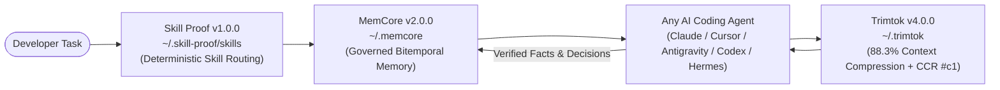

<div align="center">

# MemCore

**Governed, Bitemporal, Local-First Memory Engine for Autonomous AI Agent Fleets**

<p><em>Capture broadly. Recall narrowly. Never trust raw conversational history.</em></p>

<p>
  <a href="https://github.com/Stxyu-p/memcore/releases"></a>
  
  
  
  <a href="LICENSE"></a>
</p>

<p>
  <a href="#what-is-memcore">Overview</a> ·
  <a href="#the-global-agent-trinity-recommended-combo">Global Trinity Combo</a> ·
  <a href="#quick-start">Quick Start</a> ·
  <a href="#architecture--trust-model">Architecture</a> ·
  <a href="#measured-performance--footprint">Performance</a> ·
  <a href="#python-sdk--cli">Python SDK & CLI</a> ·
  <a href="#serving-multi-agent-fleets">Multi-Agent Fleets</a>
</p>

</div>

---

## What is MemCore?

Most AI agent memory frameworks dump raw conversational logs directly into prompts or unverified vector stores. Over time, this causes prompt bloat, hallucinated facts, and state poisoning — when an agent makes a mistake once, that mistake is re-injected as truth in future sessions.

**MemCore v2.0.0 solves this with governed, bitemporal memory and hard SQL-enforced trust boundaries:**

1. **Raw Ingest Journal (`Untrusted`):** An append-only ledger (`ingest_event`) that records turns, tool executions, and delegations. It is **never** injected directly into prompts until reviewed and promoted.
2. **Governed Canonical Memory (`Authoritative`):** Verified facts, architectural decisions, preferences, and constraints carrying explicit `scope`, `lifecycle`, `verification`, and `freshness` labels.
3. **Sub-Millisecond Hybrid Recall:** Combines SQLite **FTS5 BM25** lexical search with in-process **`sqlite-vec` SIMD** vector distance and **`model2vec`** static embeddings (`minishlab/potion-base-8M`) via Reciprocal Rank Fusion (RRF, $k=60$) — requiring **zero background daemons**, zero Docker containers, and zero open network ports.

<div align="center">
  
</div>

---

## The Global Agent Trinity (Recommended Combo)

For the complete local-first AI engineering stack, pair **MemCore** with [**Trimtok**](https://github.com/Stxyu-p/trimtok) and [**Skill Proof**](https://github.com/Stxyu-p/skill-proof). Together, they connect every AI coding client on your machine (**Claude Code, Cursor, Antigravity, Gemini CLI, Codex, VS Code Copilot, Windsurf, OpenCode, Cline, and Hermes**) to three unified global hubs:



| Layer | Engine | Global Hub | What You Gain When Installed Together |
| :--- | :--- | :--- | :--- |
| **1. Governed Memory** | [**MemCore v2.0.0**](https://github.com/Stxyu-p/memcore) | `~/.memcore` | **One Shared Brain Across All Clients:** Fix a bug or lock an architectural decision in Cursor, and Claude Code, Antigravity, or Codex immediately recall the verified truth. |
| **2. Context Shield** | [**Trimtok v4.0.0**](https://github.com/Stxyu-p/trimtok) | `~/.trimtok` | **88.3% Less Context Noise:** Compresses noisy terminal logs, tracebacks, diffs, AST code bodies, and JSON outputs while keeping every byte recoverable via `#c1` aliases. |
| **3. Skill Routing** | [**Skill Proof v1.0.0**](https://github.com/Stxyu-p/skill-proof) | `~/.skill-proof/skills` | **One Skill Vault, Zero Prompt Bloat:** Consolidates dispersed `SKILL.md` directories into one global vault and routes tasks deterministically in `< 1 ms` without extra LLM calls. |

### One-Command Trinity Setup

```bash
# 1. Install all three engines (includes sqlite-vec, model2vec, msgspec, rapidfuzz, zstandard, tiktoken)
pip install memcore trimtok skill-proof

# 2. Initialize MemCore & auto-register MCP servers across all detected AI coding clients
memcore init
memcore install
trimtok install
skill-proof install

# 3. Consolidate dispersed agent skills into the global vault (~/.skill-proof/skills)
skill-proof vault migrate
```

---

## Quick Start

### 1. Universal One-Command Auto-Install

Install `memcore` and automatically register its stdio MCP server across every detected AI agent CLI and IDE:

```bash
pip install memcore
memcore init
memcore install
```

`memcore install` atomically registers `memcore` into:
- **Claude Code** (`~/.claude.json`) & **Claude Desktop** (`claude_desktop_config.json`)
- **Google Antigravity & Antigravity IDE** (`~/.gemini/config/mcp_config.json`, `~/.gemini/antigravity/mcp_config.json`)
- **Gemini CLI** (`~/.gemini/settings.json`) & **Codex CLI** (`~/.codex/config.toml`)
- **Cursor** (`~/.cursor/mcp.json`), **Windsurf**, **VS Code (Copilot)**, **OpenCode**, and **Cline**

Inspect detected clients or run a full governance & schema health check:

```bash
memcore clients
memcore doctor
```

---

## Architecture & Trust Model

### Modular Package Layout (`memcore v2.0.0`)

| Module | Role | Key Responsibilities |
| :--- | :--- | :--- |
| `memcore/store.py` | **SQLite WAL + `sqlite-vec` Storage** | Schema migrations, FTS5 sync triggers, custom SQL math functions, and locked-down `sqlite-vec` SIMD vector loading. |
| `memcore/write.py` | **Governed Write & Lifecycle Engine** | Claim fingerprinting, idempotency keys, bitemporal `supersede`, `promote`, `reject`, tombstone refusal guards, and corroboration funnel. |
| `memcore/recall.py` | **Hybrid RRF Search & Salience L1** | SQL-enforced scope filtering, FTS5 BM25 + dense vector RRF ($k=60$), freshness/decay scoring, and 180-char Salience L1 constraint previews. |
| `memcore/doctor.py` | **Governance Audit & Retention GC** | Fingerprint integrity verification, tombstone scope validation, reversible candidate retention cleanup (`gc_apply`), and operational telemetry. |
| `memcore/imports.py` | **Ingest & Cross-Format Import** | JSONL/Markdown import with secret redaction, duplicate detection, and provenance preservation. |
| `memcore/embedding.py` | **Multi-Tier Embedding Engine** | In-process `model2vec` (`StaticModel`), `fastembed` (ONNX), `ollama`, `openrouter`, `openai`, and pure-offline lexical fallback. |
| `memcore/core.py` | **Unified Engine Facade** | Attribute-synchronizing module proxy preserving 100% backward compatibility across all callers and test harnesses. |
| `memcore/mcp_server.py` | **Stdio MCP Server** | Exposes 9 governed memory tools (`memory_remember`, `memory_search`, `memory_promote`, `memory_supersede`, `memory_reject`, `memory_feedback`, `memory_review_queue`, `memory_review_decide`, `memory_status`). |

### Four-Dimensional Trust Labels

Every recalled memory carries four explicit labels so agents know exactly how to weight it:

| Dimension | Values | Meaning |
| :--- | :--- | :--- |
| **`scope`** | `project` \| `private` | Enforced directly in SQL `WHERE` clauses — Agent A can never read Agent B's private notes. |
| **`lifecycle`** | `accepted` \| `candidate` \| `conflict` \| `superseded` \| `rejected` \| `disabled` | Tracks whether a claim is canonical truth, awaiting corroboration, or blocked by a tombstone. |
| **`verification`** | `user_authoritative` \| `runtime_verified` \| `source_backed` \| `unverified` | Ranks proven runtime/user facts above unverified observations. |
| **`freshness`** | `current` \| `aging` \| `stale` | Automatically marks `source_file`-backed memories `stale` when the file's SHA-256 changes on disk. |

---

## Measured Performance & Footprint

Measured on local disk with SQLite WAL, FTS5 BM25, and hybrid RRF retrieval (`docs/BENCHMARKS.md`):

| Metric | MemCore v2.0.0 (In-Process SQLite WAL) | External Daemon / Remote Vector DB |
| :--- | :--- | :--- |
| **Background Daemon RAM** | **0 MB** (100% in-process) | 300 MB – 1 GB+ (Docker / server process) |
| **Store Initialization** | **< 1.0 ms** (`0.9 ms` p50) | 2,000 – 5,000 ms (service boot / handshake) |
| **Indexed Claim Lookup** | **0.017 ms** (`17 µs` p50) | 15 – 35 ms (network round-trip) |
| **Hybrid Recall Latency (`p50`)** | **2.24 ms** (1,000 iterations) | 25 – 60 ms (HTTP/gRPC + remote vector query) |
| **Tail Recall Latency (`p95`)** | **4.80 ms** | 75 – 150 ms |
| **Hybrid Recall Precision (`p@3`)** | **1.00** (exact, negation, paraphrase) | Varies |
| **Batch Ingestion Rate** | **1,650 writes/sec** | 50 – 150 writes/sec |
| **Network Attack Surface** | **Zero open ports** (offline-first) | Exposed HTTP/gRPC ports |

---

## Python SDK & CLI

### Python SDK

```python
from memcore.client import MemCore

with MemCore(project="platform", agent="sora") as mc:
    # 1. Store a governed fact bound to a source file for automatic SHA-256 staleness tracking
    mem_id = mc.remember(
        "ClickHouse telemetry analytics runs on port 9000",
        memory_type="fact",
        source_file="src/settings.py",
    )

    # 2. Hybrid recall (FTS5 BM25 + Dense Vector RRF Fusion)
    hits = mc.search("telemetry database port")
    for hit in hits:
        print(f"[{hit['scope']} | {hit['verification']} | {hit['freshness']}] {hit['content']}")

    # 3. Bitemporal update (preserves immutable prior version history)
    mc.supersede(
        mem_id,
        "ClickHouse telemetry analytics migrated to port 9440 with mTLS",
        reason="security hardening",
    )
```

### Operational CLI

```bash
# Database health, WAL integrity, governance invariants, and backup readiness
memcore doctor

# Store and search memories directly from the terminal
memcore remember "Python 3.10+ required for core services" --project platform --agent sora
memcore search "python version" --project platform --agent sora

# Backfill or refresh local embeddings
memcore embed --provider local --all

# Create and verify atomic database snapshots
memcore backup
memcore backup-status

# Review raw journal events and apply governed triage decisions
memcore journal-stats
memcore journal-review-list --project platform --agent sora
memcore journal-review-decide <event-id> --verdict remember --content "Verified fact" --agent sora
```

---

## Serving Multi-Agent Fleets

MemCore exports governed project memory into deterministic, SHA-256-signed instruction files so every agent in your workspace reads from the same canonical truth:

<table width="100%">
  <tr>
    <td align="center" width="25%"><br /><sub>Antigravity</sub></td>
    <td align="center" width="25%"><br /><sub>Codex</sub></td>
    <td align="center" width="25%"><br /><sub>Claude Code</sub></td>
    <td align="center" width="25%"><br /><sub>Cursor</sub></td>
  </tr>
  <tr>
    <td align="center" width="25%"><br /><sub>DeepSeek Harness</sub></td>
    <td align="center" width="25%"><br /><sub>Hermes</sub></td>
    <td align="center" width="25%"><br /><sub>OpenCode</sub></td>
    <td align="center" width="25%"><br /><sub>Gemini CLI</sub></td>
  </tr>
</table>

```bash
memcore export                      # Writes governed workspace AGENTS.md
memcore export --host claude-code   # Writes CLAUDE.md
memcore export --host gemini-cli    # Writes GEMINI.md
memcore export --host copilot       # Writes .github/copilot-instructions.md
```

### Verification Suite

```bash
# Run the complete 605-test governance, bitemporal, concurrency, and recall harness
python -m unittest discover -s harness -p "test_*.py"
```

---

## License

Distributed under the [MIT License](LICENSE). Designed and maintained by **P Choke & SORA**.
