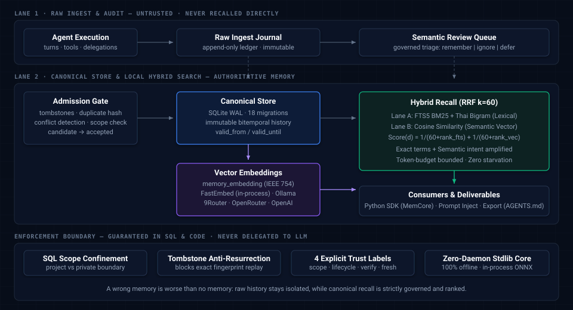
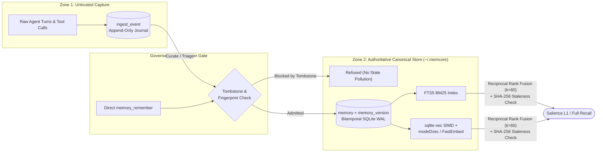
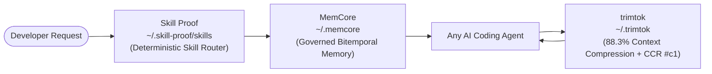

<div align="center">

# MemCore

**Governed, Bitemporal, Local-First Memory Engine for Autonomous AI Agent Fleets**

<p><em>Capture broadly. Recall narrowly. Never trust raw conversational history.</em></p>

<p>
  
  
  
  
  <a href="LICENSE"></a>
</p>

<p>
  <a href="#why-memcore">Why MemCore</a> ·
  <a href="#visual-before--after-ungoverned-rag-vs-memcore">Before / After</a> ·
  <a href="#quick-start">Quick Start</a> ·
  <a href="#how-governed-memory-works">Trust & Lifecycle</a> ·
  <a href="#hybrid-rrf-recall--vector-providers">Hybrid Recall</a> ·
  <a href="#architecture--modules">Architecture</a> ·
  <a href="#measured-performance--footprint">Performance</a> ·
  <a href="#python-sdk--operational-cli">SDK & CLI</a> ·
  <a href="#recommended-ecosystem-combo">Trinity Combo</a>
</p>

</div>

---

## Why MemCore?

Most AI agent memory frameworks dump raw conversational logs directly into prompts or unverified vector stores. Over time, this creates three fatal failure modes:
1. **State Poisoning:** When an agent guesses wrong once, that wrong assumption is embedded and re-injected as "truth" in future sessions.
2. **Stale Code Drift:** Facts about a codebase stay frozen in vector memory long after the underlying source file has been refactored.
3. **Cross-Agent Isolation Leaks:** Private agent scratchpads bleed into shared project context without access-control boundaries.

**MemCore solves this by introducing governed, bitemporal memory with hard SQL-enforced trust boundaries (`~/.memcore`):**

- **Two-Zone Isolation:** Separates the **Raw Ingest Journal (`Untrusted`)** — an append-only ledger of turns and tool calls that is *never* recalled into prompts — from **Governed Canonical Memory (`Authoritative`)**.
- **Bitemporal Versioning & Tombstone Refusal Guards:** Corrections (`supersede`) create immutable version chains tracking both valid-world time and transaction time. Rejected claims leave a cryptographic **Tombstone** that blocks identical bad claims from ever being re-admitted.
- **Source-File SHA-256 Staleness Detection:** Memories bound to a `source_file` automatically flip their `freshness` label to `stale` the instant that file's SHA-256 changes on disk — while unrelated Git commits leave it untouched.
- **Sub-Millisecond Hybrid RRF Recall:** Fuses SQLite **FTS5 BM25** lexical search with in-process **`sqlite-vec` SIMD** vector distance and **`model2vec`** static embeddings (`minishlab/potion-base-8M`) via Reciprocal Rank Fusion (RRF, $k=60$) — requiring **zero background daemons**, zero Docker containers, and zero open network ports.

> [!IMPORTANT]
> **Hard SQL Scope Guarantee:** Project-wide (`project`) vs. agent-private (`private`) visibility rules are enforced directly inside SQL `WHERE` clauses (`recall.py`) — never in Python post-filtering. Agent A can never read Agent B's private notes, even under broad semantic vector search.

<div align="center">
  
</div>

---

## Visual Before & After: Ungoverned RAG vs. MemCore

<table>
<tr>
<th width="50%">Ungoverned Vector RAG Memory</th>
<th width="50%">MemCore Governed Bitemporal Memory</th>
</tr>
<tr>
<td>

```text
Query: "What port does ClickHouse use?"

Recalled Chunks (Unfiltered Cosine Similarity):
1. [0.89] "Let's try connecting to ClickHouse on 8123..."
2. [0.87] "ClickHouse runs on port 9000 in settings.py"
3. [0.85] "We migrated ClickHouse to port 9440 with TLS"

Result:
❌ Contradictory history dumped into prompt
❌ Old port 9000 and failed guess 8123 pollute context
❌ No way to know if settings.py changed since last week
```

</td>
<td>

```text
Query: "What port does ClickHouse use?"

Recalled Canonical Memory (Hybrid FTS5 + Vector RRF):
1. [scope=project | lifecycle=accepted
    | verification=source_backed | freshness=current]
   "ClickHouse telemetry analytics migrated to port 9440
    with mTLS (settings.py)"
   └─ supersedes: v1 ("port 9000", valid_until: 2026-10-18)
   └─ tombstone: "port 8123" blocked (rejected)

Result:
✅ Only active canonical truth is returned
✅ Prior version preserved in immutable audit history
✅ SHA-256 of settings.py verified current at read time
```

</td>
</tr>
</table>

---

## Quick Start

### 1. Universal One-Command Auto-Install (Recommended)

Install `memcore`, initialize the governed store, and automatically register its stdio MCP server across every supported AI agent CLI and IDE on your machine:

```bash
pip install memcore-omnix
memcore init
memcore install
```

`memcore install` detects and atomically updates:
- **Claude Code** (`~/.claude.json` via official `claude mcp add-json`) & **Claude Desktop** (`claude_desktop_config.json`)
- **Google Antigravity & Antigravity IDE** (`~/.gemini/config/mcp_config.json`, `~/.gemini/antigravity/mcp_config.json`)
- **Gemini CLI** (`~/.gemini/settings.json`) & **Codex CLI** (`~/.codex/config.toml` with atomic TOML validation)
- **Cursor** (`~/.cursor/mcp.json`), **Windsurf**, **VS Code (Copilot)**, **OpenCode**, and **Cline**

Inspect detected clients or run a full governance & schema diagnostic:

```bash
memcore clients
memcore doctor
```

---

## How Governed Memory Works



### Four-Dimensional Trust Labels

Every recalled memory carries four explicit labels so the consuming agent knows exactly how much authority it holds:

| Dimension | Allowed Values | Engineering Meaning |
| :--- | :--- | :--- |
| **`scope`** | `project` · `private` | `project` is shared across all agents in the workspace; `private` is strictly isolated to `owner_agent_id` in SQL. |
| **`lifecycle`** | `accepted` · `candidate` · `conflict` · `superseded` · `rejected` · `disabled` | Only live memories (`accepted` / `candidate` / `conflict`) appear in standard recall; `superseded` and `rejected` stay in audit history. |
| **`verification`** | `user_authoritative` · `runtime_verified` · `source_backed` · `unverified` | Ranks explicit user rules and runtime-proven facts above unverified observations. |
| **`freshness`** | `current` · `aging` · `stale` | Automatically transitions `source_backed` claims to `stale` when the tracked `source_file` SHA-256 changes on disk. |

### Salience L1 Progressive Recall

When an agent searches memory with `include_content=False` (or during compact context injection), MemCore generates a **180-character Salience L1 Preview** (`recall.py`) that prioritizes:
1. Hard negations and prohibitions (`never`, `must not`, `ห้าม`)
2. Numerical bounds, ports, timeouts, and version constraints
3. File paths and module identifiers

This cuts memory injection token overhead by **up to 80%** while keeping critical constraints visible, letting the agent fetch full bodies only for the exact IDs it needs.

---

## Hybrid RRF Recall & Vector Providers

MemCore fuses lexical exactness (SQLite FTS5 BM25 + Unicode substring matching for technical identifiers and spaceless scripts) with dense vector semantics using Reciprocal Rank Fusion ($k=60$).

Configure your embedding provider via `--provider` or `MEMCORE_EMBEDDING_PROVIDER`:

| Provider | Default Model | Execution Mode | Highlights |
| :--- | :--- | :--- | :--- |
| **`local` / `model2vec`** | `minishlab/potion-base-8M` | **In-Process Static Vectors** | Ultra-lightweight sub-millisecond static embeddings in pure CPU RAM; zero daemon. |
| **`local` / `fastembed`** | `BAAI/bge-small-en-v1.5` | **In-Process ONNX (CPU)** | High-precision 384-dim ONNX embeddings running directly in-process (~30 MB). |
| **`ollama`** | `nomic-embed-text` | **Local Daemon** | Connects to a local Ollama instance (`localhost:11434`). |
| **`openrouter`** | `text-embedding-3-small` | **Remote Gateway** | Uses OpenRouter API (`OPENROUTER_API_KEY`). |
| **`openai`** | `text-embedding-3-small` | **Cloud API** | Uses OpenAI API (`OPENAI_API_KEY`). |
| **`none`** | *(Disabled)* | **Pure Lexical Offline** | Zero-dependency SQLite FTS5 BM25 + Unicode substring matching. |

---

## Architecture & Modules

| Module | Role | Key Responsibilities |
| :--- | :--- | :--- |
| `memcore/store.py` | **SQLite WAL + `sqlite-vec` Storage** | Schema initialization, atomic migrations under lock, FTS5 sync triggers, custom SQL math functions, and locked-down `sqlite-vec` SIMD extension loading. |
| `memcore/write.py` | **Governed Write & Lifecycle Engine** | Claim normalization & SHA-256 fingerprinting, idempotency keys, bitemporal `supersede`, `promote`, `reject`, tombstone refusal guards, and corroboration funnel. |
| `memcore/recall.py` | **Hybrid RRF Search & Salience L1** | SQL-enforced scope filtering, FTS5 BM25 + dense vector RRF ($k=60$), freshness/decay scoring, point-in-time `version_at` queries, and Salience L1 previews. |
| `memcore/doctor.py` | **Governance Audit & Retention GC** | Fingerprint integrity checks, tombstone scope validation, reversible candidate retention cleanup (`gc_scan` / `gc_apply`), and operational stats. |
| `memcore/imports.py` | **Ingest & Cross-Format Import** | JSONL and Markdown memory import with automatic secret redaction, deduplication, and provenance binding. |
| `memcore/embedding.py` | **Multi-Tier Embedding Engine** | Unified provider adapter supporting `model2vec` (`StaticModel`), `fastembed`, `ollama`, `openrouter`, and `openai` with automatic batching and fallback. |
| `memcore/ingest.py` | **Journal & Semantic Triage** | Append-only `ingest_event` capture, derivation tracking (`ingest_derivation`), and governed review queue (`memory_review_queue` / `memory_review_decide`). |
| `memcore/core.py` | **Unified Engine Facade** | Attribute-synchronizing module proxy re-exporting `write`, `recall`, `doctor`, and `imports`. |
| `memcore/mcp_server.py` | **Stdio MCP Server** | Exposes 9 governed memory tools over newline-delimited JSON-RPC 2.0. |
| `memcore/mcp_install.py` | **Universal Client Installer** | Atomically registers/unregisters `memcore` across 11 AI agent CLIs and IDEs. |

---

## Measured Performance & Footprint

Measured on local disk with SQLite WAL, FTS5 BM25, and hybrid RRF retrieval (`docs/BENCHMARKS.md`):

| Metric | MemCore (In-Process SQLite WAL) | External Daemon / Remote Vector DB |
| :--- | :--- | :--- |
| **Background Daemon RAM** | **0 MB** (100% in-process) | 300 MB – 1 GB+ (Docker / server process) |
| **Store Initialization** | **< 1.0 ms** (`0.9 ms` p50) | 2,000 – 5,000 ms (service boot / handshake) |
| **Indexed Claim Lookup** | **0.017 ms** (`17 µs` p50) | 15 – 35 ms (network round-trip) |
| **Hybrid Recall Latency (`p50`)** | **2.24 ms** (1,000 iterations) | 25 – 60 ms (HTTP/gRPC + remote vector query) |
| **Tail Recall Latency (`p95`)** | **4.80 ms** | 75 – 150 ms |
| **Hybrid Recall Precision (`p@3`)** | **1.00** (exact, negation, paraphrase) | Varies |
| **Batch Ingestion Rate** | **1,650 writes/sec** | 50 – 150 writes/sec |
| **Network Attack Surface** | **Zero open ports** (offline-first) | Exposed HTTP/gRPC ports |

---

## Python SDK & Operational CLI

### Python SDK

```python
from memcore.client import MemCore

with MemCore(project="platform", agent="sora") as mc:
    # 1. Store a governed fact bound to a source file for automatic SHA-256 staleness tracking
    mem_id = mc.remember(
        "ClickHouse telemetry analytics runs on port 9000",
        memory_type="fact",
        source_file="src/settings.py",
    )

    # 2. Hybrid recall (FTS5 BM25 + Dense Vector RRF Fusion)
    hits = mc.search("telemetry database port")
    for hit in hits:
        print(f"[{hit['scope']} | {hit['verification']} | {hit['freshness']}] {hit['content']}")

    # 3. Bitemporal update (preserves immutable prior version history)
    mc.supersede(
        mem_id,
        "ClickHouse telemetry analytics migrated to port 9440 with mTLS",
        reason="security hardening",
    )
```

### MCP Tools Exposed (`memcore.mcp_server`)

| MCP Tool | Purpose |
| :--- | :--- |
| **`memory_remember`** | Store a governed fact, decision, preference, or note (with optional `source_file` and `source_commit` provenance). |
| **`memory_search`** | Hybrid FTS5 BM25 + dense vector RRF recall with Salience L1 preview or full content. |
| **`memory_supersede`** | Bitemporally update an existing memory while keeping immutable version history. |
| **`memory_promote`** | Promote a private agent memory to shared project scope. |
| **`memory_reject`** | Reject a memory claim and install a cryptographic tombstone refusal guard. |
| **`memory_feedback`** | Mark a recalled memory `accepted`, `rejected`, or `stale` after task execution. |
| **`memory_review_queue`** | List pending raw journal events awaiting governed curation. |
| **`memory_review_decide`** | Apply a governed verdict (`remember`, `ignore`, `defer`) to a pending journal event. |
| **`memory_status`** | Inspect database health, WAL mode, governance invariants, and memory counts. |

<details>
<summary><strong>🛠️ Click to expand: Full Operational CLI & Multi-Agent Export Commands</strong></summary>

<br/>

```bash
# Database health, WAL integrity, governance invariants, and backup readiness
memcore doctor

# Store and search memories directly from the terminal
memcore remember "Python 3.10+ required for core services" --project platform --agent sora
memcore search "python version" --project platform --agent sora

# Backfill or refresh local embeddings
memcore embed --provider local --all

# Create, verify, and restore atomic database snapshots
memcore backup
memcore backup-status
memcore restore-from-snapshot --snapshot <snapshot-name> --confirm

# Review raw journal events and apply governed triage decisions
memcore journal-stats
memcore journal-review-list --project platform --agent sora
memcore journal-review-decide <event-id> --verdict remember --content "Verified fact" --agent sora

# Export governed project memory into deterministic, SHA-256-signed workspace instruction files
memcore export                      # Writes workspace AGENTS.md
memcore export --host claude-code   # Writes CLAUDE.md
memcore export --host gemini-cli    # Writes GEMINI.md
memcore export --host copilot       # Writes .github/copilot-instructions.md
```

</details>

### Multi-Agent Ecosystem Support

<table width="100%">
  <tr>
    <td align="center" width="25%"><br /><sub>Antigravity</sub></td>
    <td align="center" width="25%"><br /><sub>Codex</sub></td>
    <td align="center" width="25%"><br /><sub>Claude Code</sub></td>
    <td align="center" width="25%"><br /><sub>Cursor</sub></td>
  </tr>
  <tr>
    <td align="center" width="25%"><br /><sub>DeepSeek Harness</sub></td>
    <td align="center" width="25%"><br /><sub>Hermes</sub></td>
    <td align="center" width="25%"><br /><sub>OpenCode</sub></td>
    <td align="center" width="25%"><br /><sub>Gemini CLI</sub></td>
  </tr>
</table>

---

## Recommended Ecosystem Combo

While **MemCore** operates standalone as your governed memory engine, pairing it with [**trimtok**](https://github.com/Stxyu-p/trimtok) and [**Skill Proof**](https://github.com/Stxyu-p/skill-proof) completes the **Global Agent Trinity** — uniting every AI coding client on your machine around three shared local hubs:



| Pillar | Repository | Global Hub | What Installing All 3 Gives You |
| :--- | :--- | :--- | :--- |
| **Governed Memory** | **[MemCore](https://github.com/Stxyu-p/memcore)** | `~/.memcore` | Gives every IDE and CLI **one shared bitemporal brain** (`FTS5` + `sqlite-vec` SIMD + `model2vec`) with hard trust boundaries and source-file staleness tracking. |
| **Context Shield** | **[trimtok](https://github.com/Stxyu-p/trimtok)** | `~/.trimtok` | Cuts terminal, traceback, diff, AST code, and JSON token bloat by **88.3%** with instant `#c1` lossless recovery. |
| **Skill Vault & Router** | **[Skill Proof](https://github.com/Stxyu-p/skill-proof)** | `~/.skill-proof/skills` | Consolidates all dispersed `SKILL.md` playbooks into **one deduplicated global vault** and routes tasks in `< 1 ms` with zero routing LLM calls. |

```bash
# Install & link the complete Global Agent Trinity across all your IDEs and CLIs
pip install memcore-omnix trimtok skill-proof
memcore init && memcore install && trimtok install && skill-proof install
skill-proof vault migrate
```

---

## Verification & License

```bash
# Run the complete 605-test governance, bitemporal, concurrency, and hybrid recall harness
python -m unittest discover -s harness -p "test_*.py"
```

Distributed under the [MIT License](LICENSE). Designed and maintained by **P Choke & SORA**.
